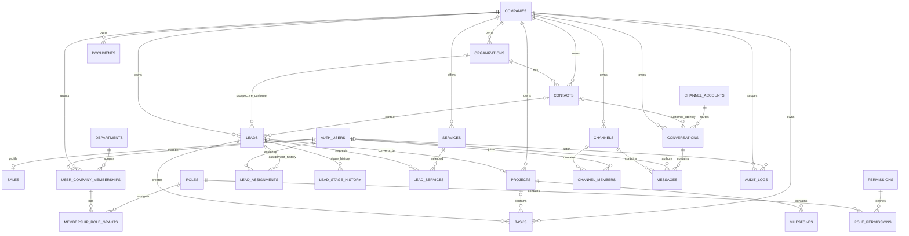

# Group CRM target ERD (Phase 0)

Status: design proposal for review; no schema changes have been made. This ERD describes the target domain model, not the current Atomic CRM schema. See `atomic-crm-map.md` for the existing model and migration risks.

## Entity rules

- `companies` means the three operating-company tenants (Goldland, Abbadi Tech, Casavera). Rename Atomic CRM's current customer-company table to `organizations` before creating this tenant table. Legacy `contacts.company_id` and `deals.company_id` must become `organization_id`; reserve new `company_id` for tenant scope.
- Every tenant-owned row carries a non-null `company_id`. Group-owned rows use an explicit `scope = 'GROUP'` and a constraint that distinguishes them from `scope = 'COMPANY'`; do not use NULL to mean group-wide.
- Identity remains one Supabase `auth.users` identity per person. Keep Atomic's `sales` table as the profile table. Proposed membership FK is `user_id -> auth.users.id` so database policies can use `auth.uid()` directly; verify the profile/membership lifecycle before implementation.
- Memberships have `status`, `effective_from`, `effective_to`, `is_temporary`, `review_by`, `approved_by`, and revocation metadata. Role grants are separate rows so a person can hold multiple company-scoped roles. Temporary grants are inert until approved and within dates.
- `organizations` and `contacts` are tenant-scoped in v1. Cross-company customer/contact sharing is not implicit; if required, use an explicit audited sharing grant rather than a global identity row.
- `leads` replace Atomic `deals`. Preserve source IDs during the migration or add a reversible legacy-ID mapping. Lead/contact and lead/service relations use join tables rather than arrays. Lead stage changes and assignments are append-only history.
- `projects` are created from won leads transactionally with starter tasks. Drive folder creation is asynchronous and idempotent; a document row stores Drive metadata and entity linkage, not file bytes or broad Drive ACLs.
- `messages` are tenant-scoped. A channel has explicit company/group scope and membership. Direct messages and private channels do not feed engagement scoring.
- WhatsApp identity fields (`wa_id`, `bsuid`, normalized phone) remain distinct. Never use phone alone as a person key. A `channel_account` identifies the destination business number/company.
- `audit_logs` are append-only and record actor, company/scope, action, target, timestamp, request/correlation ID, and minimal before/after metadata. Avoid copying secrets or unnecessary PII into the log.

## Key constraints to decide during implementation

1. Whether multiple leads may convert to one project, and whether a project may exist without a lead.
2. Whether `contacts` are duplicated by tenant or centrally canonicalized with explicit tenant access grants. The safest v1 default is tenant-local.
3. Whether role grants belong directly to memberships or to a normalized assignment table; the diagram assumes `membership_role_grants`.
4. Exact FK behavior for archived/deleted users and leads. Prefer archive/revoke over destructive cascades for business history.
5. Human-readable code format and sequence allocation; use a database-safe allocator, not client-side counters.
